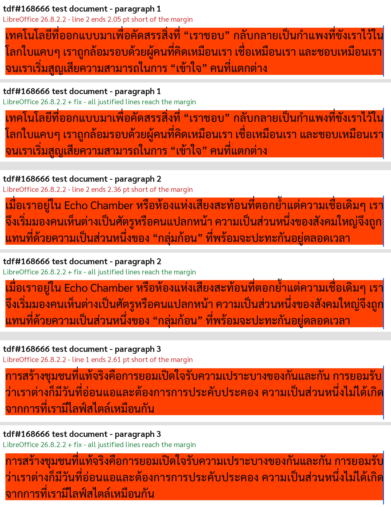

# LibreOffice tdf#168666: Thai justification skipped on lines with little extra space

Evidence, fix and unit test for
[tdf#168666 "Thai Distributed Bug"](https://bugs.documentfoundation.org/show_bug.cgi?id=168666).

> **AI disclosure.** The analysis, the code change, the unit test, the test document, the scripts
> and this README were produced with the help of an LLM: Claude Opus 5.5 (Anthropic), used through
> OpenCode. Steps: reproducing the bug, measuring line ends in the exported PDFs, locating the
> cause in the source, writing the fix and the test, building LibreOffice with and without the fix.
> The patch has **not** been submitted to Gerrit yet; the commit message in the branch below is a
> placeholder that the author will replace, as required by the
> [LibreOffice AI policy](https://wiki.documentfoundation.org/Development/AI_policy).

- Branch: [`pramoth/libreoffice-core@tdf168666`](https://github.com/pramoth/libreoffice-core/tree/tdf168666)
  (fix + unit test, based on master `00f25a77`)
- Patches: [`patch/`](patch/)



## Symptom

In a justified paragraph with Thai text (CTL language Thai, i.e. LibreOffice's "Thai
Distributed"), some lines end short of the right margin. It does not depend on the last character
of the line.

## Cause

`sw/source/core/txtnode/fntcache.cxx`, `SwFntObj::DrawText()` and
`SwFntObj::GetModelPositionForViewPoint()`:

```cpp
tools::Long nSpaceAdd = rInf.GetSpace() / SPACING_PRECISION_FACTOR;   // 1/100 twip -> whole twips
...
if ( SwFontScript::CTL == nActual && nSpaceAdd )                      // 0 when < 1 twip per cell
    SwScriptInfo::ThaiJustify( ..., rInf.GetSpace() );                 // uses the precise value
```

When a line needs less than 1 twip of extra space per character cell, the truncated value is 0 and
`ThaiJustify()` is not called at all, while the layout already counted with the justified width.
The line is painted unjustified.

## Fix

Test the precise value `rInf.GetSpace()` instead of the truncated `nSpaceAdd` in both places
([`patch/fix-only.patch`](patch/fix-only.patch)).

## Measurements

Bug attachment 206239 (Sarabun 14 pt, A4, 2 cm margins, right edge of the text area = 538.7 pt),
exported to PDF by LibreOffice 26.8.2.2 built from source (Debian 13, aarch64, headless). Line ends
from `pdftotext -bbox-layout` ([`scripts/line_ends.py`](scripts/line_ends.py)):

| Line | Left aligned | Justified, 26.8.2.2 | Justified, 26.8.2.2 + fix |
|---|---|---|---|
| paragraph 1, line 2 | 536.66 | **536.66** | **538.63** |
| paragraph 2, line 2 | 536.21 | **536.21** | **538.71** |
| paragraph 3, line 1 | 536.08 | **536.08** | **538.68** |
| all other lines | | unchanged | unchanged |

The broken lines end exactly where they end with left alignment, i.e. they get no justification.
The same values were measured with LibreOffice 26.8.1.1 on macOS (TDF build) and in the
`gotenberg/gotenberg:8-libreoffice` image (Debian package).

Predicting the broken lines from the extra space per cell
([`scripts/per_cell_space.py`](scripts/per_cell_space.py)):

| Line | Cells | Extra space per cell | Predicted | Observed |
|---|---|---|---|---|
| paragraph 1, line 1 | 63 | 3.96 twip | justified | justified |
| paragraph 1, line 2 | 65 | 0.64 twip | not justified | not justified |
| paragraph 2, line 1 | 65 | 2.99 twip | justified | justified |
| paragraph 2, line 2 | 62 | 0.82 twip | not justified | not justified |
| paragraph 3, line 1 | 63 | 0.85 twip | not justified | not justified |
| paragraph 3, line 2 | 62 | 4.50 twip | justified | justified |

## Unit test

`testTdf168666ThaiJustifySmallSpace` in `sw/qa/core/txtnode/txtnode.cxx` with
[`test/tdf168666.fodt`](test/tdf168666.fodt): paragraph 3 of the bug document, with an embedded,
renamed subset of Sarabun (SIL OFL 1.1) so the layout does not depend on installed fonts
([`scripts/make_test_document.py`](scripts/make_test_document.py)). It compares the painted width
of the first line (metafile dump) with the width of the print area.

| Build (26.8.2.2 tree) | Result |
|---|---|
| without the fix | fails: expected 9638, actual 9586 |
| with the fix | passes |

`CppunitTest_sw_core_txtnode` passes completely with the fix, and so does
`testThaiJustifyPortxt` from master. The test file is clean with clang-format 5.0.0;
`fntcache.cxx` is in `solenv/clang-format/excludelist`.

## Reproduce

```bash
docker build --target lo-unpatched -t lo-tdf168666:unpatched -f docker/Dockerfile .
docker build --target lo-patched   -t lo-tdf168666:patched   -f docker/Dockerfile .

# with Sarabun (https://fonts.google.com/specimen/Sarabun) in ./fonts and the bug attachment in ./in
for v in unpatched patched; do
  docker run --rm -u 1000 -v "$PWD:/w" lo-tdf168666:$v bash -c \
    "mkdir -p ~/.fonts && cp /w/fonts/*.ttf ~/.fonts && fc-cache -f >/dev/null &&
     /build/core/instdir/program/soffice --headless --convert-to pdf --outdir /w/out-$v /w/in/*"
done
python3 scripts/line_ends.py out-unpatched/<file>.pdf
python3 scripts/line_ends.py out-patched/<file>.pdf
```

The PDFs used for the tables are in [`evidence/`](evidence/).

## License

The patch is offered under the LibreOffice licenses (MPL-2.0 / LGPLv3+). The embedded font subset
in the test document is Sarabun, SIL Open Font License 1.1. The scripts are MPL-2.0.
